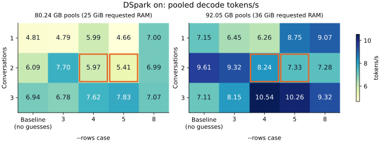

# DeepSeek batched DSpark drafting, 5 November 2026

`strata-ds41` now drafts for several conversations in one batched DSpark network forward per step.
The shared step still divides `--rows` among conversations. There is no new setting or automatic mode.
Use the existing `--dspark` / `drafter`, `--rows`, and `--batch` / live Conversations at once controls.
Qwen's family code is unchanged; its shared-step hooks retain the individual proposal path.

The two-conversation/small-draft hypothesis is **not established for the balanced three-prompt workload**.
The grids' nominal maxima are three conversations: `--rows 5` at 80.24 GB and `--rows 4` at 92.05 GB.
The close reversed-order, two-conversation seasons/repetition check does favor `--rows 5`: **16.84 tok/s
versus 14.97 without guesses (+12.5%)**. That supports the small-window choice for this pair, not a measured
concurrency optimum. Fresh controls also differ materially from the long grids (larger-pool on: 16.67
versus 10.54 tok/s at the same width/row budget). `none` is faster than on at both fresh control counts.
Keep these limits when reading small ranking differences; no default or automatic policy was changed.

## Implementation

- `src/common/spec/step.cpp`, its header and test: an optional batch proposal hook shares the existing
  row allowances, confidence cuts and cooldown rules. The ordinary hook remains the fallback.
- `src/common/serve/paged_engine.cpp` and `paged_model.hpp`: page preparation and one timed batch call.
- `src/models/deepseekv41/{paged_model.cpp,ds4_model.cu,ds4_model.hpp}`: per-row conversation binding
  for both DSpark and trunk windows; separate rings, positions, proposal distributions and rollback state.
  DSpark runs layer first, across all conversations, with batched projections, experts and confidence head.
  Its fixed five-position input block gives 5/10/15 network rows for 1/2/3 eligible conversations.
  Four eligible conversations use two activation tiles at the existing 16-row kernel capacity, within
  the same layer-major forward. The Markov sampling chain remains sequential within each conversation.
  Engines opened with DSpark support use synchronous trunk steps, including while drafting is switched
  off, because rollback scratch is shared across stage groups. `none` keeps the existing group path.
- `docs/DETAILS.md` and the D8 row in `docs/MEMORY_MANAGER_PLAN.md`: behavior, measurements and limits.

## Method

Windows 11, Ryzen AI MAX+ 395 / Radeon 8060S, HIP gfx1151, engine 0.1.51, `memory-manager` at
`7562774f` plus these uncommitted changes. Same IST-DAS 2.00 bpw pack, saved 524,288 maximum context,
profile seed and three prompts as [yesterday's study](../2026-11-04-ds41-realistic/README.md): seasons,
repetition, lighthouse story. Each start uses a private metadata pack. Original model/settings/profile
files are read only. All scratch scripts, diagnostic source copies, binaries and raw logs are in
`%TEMP%/ds41-drafting`; `batched_suite.py` runs `batched_grid.py`, `batched_controls.py` and
`batched_alternating.py`. No port or user server is used.

```text
--serve --pack <private-pack> --max-context 524288 --eos 1
--dspark on --dspark-conf 0.65 --expert-cache auto
--gpu-mib 61440 --ram-mib 25600|36864
--batch 4 --concurrent 4 --remote-experts off --step-profile 1
--pause-dir <private-temp-directory>
DS4_COMMIT_CAP_GB=115
STRATA_COMMIT_RESERVE_MIB=0
```

The row/concurrency cells are changed live. Controls request 51200 MiB GPU to hold the on-mode grant
instead of granting a larger pool without DSpark. Other defaults, including five routed experts per
token, are unchanged. Greedy answers request 256 tokens. Each cell has at least two measured answers
per prompt: two three-prompt cycles for one conversation, the three pairs for two conversations, and
two all-prompt rounds for three. Each cell has a preceding batch warm-up. Before the grid, GPU expert
bytes stay constant through three idle samples and two complete three-prompt warm-up rounds. This
checks allocated residency; adaptive placement can still change which experts occupy those bytes.

Standalone rates use native decode time and its 256-token counting convention. Concurrent timing
counts tokens after the last admission through the last BDONE. Per-slot rates use that common interval;
mean each is total divided by conversation count. Draft counters cover whole answers; offered guesses
are those verified by the trunk after confidence cuts. SSD GiB counts
successful expert payload reads from submission through 100 ms after completion, including admission
and adaptive reads within that boundary. It excludes Engram, sector padding, OS and driver paging.
These are file-source counters, not SSD device traffic. Diagnostic logging overhead is not isolated.

Exact commands, prompts, allocations, round order, per-slot rates, draft counters, answer hashes and
batch timings are in [measurements.json](measurements.json). Each pool's final grid uses one engine
process. Earlier per-conversation drafter experiments and the partial 32 GiB RAM pilot are excluded.

| RAM request GiB | `--rows` at startup | GPU pool GiB | Page-locked RAM pool GiB | Combined decimal GB | Result |
|---:|---:|---:|---:|---:|---|
| 25 | 8 | 49.99 | 24.74 | 80.24 | Full grid |
| 36 | 8 | 49.99 | 35.74 | 92.05 | Full grid |
| 40 | 8 | 49.99 | 39.74 | 96.35 | Runtime failure before inference |
| 48 | 8 | 49.99 | 47.74 | 104.94 | Runtime failure before inference |

The first grant totals about 80.24 decimal GB of pools. RAM scratch is outside the page pool but inside
the memory report's mapped bytes; the JSON retains both reports. GPU pools include DSpark experts.

The earlier 40/48 GiB RAM probes pinned their pools, then failed at the first state synchronization
after READY with `unspecified launch failure`, before inference. These probes preceded the batched
forward implementation; they establish grants, not performance or a proven cause. The larger working
grid requests 36 GiB RAM. No free-commit or physical-RAM floor was imposed. Pool bytes do not establish
physical GPU residency; OS/driver paging was not measured.

The owner reports 96–99 °C GPU temperature under load. Temperature, clocks and power were not logged
per round. No cooling gaps, fan or power changes were made. Thermal variation, adaptive placement and
accumulated paused histories limit causal rankings across this long sequential grid. The existing
automatic copy-back policy also benchmarks at startup; its decision is retained in the JSON. RAM pauses can
spill to SSD as the run proceeds; the memory reports retain their counts. Ranges and fresh controls
are retained, and expert-read counters do not include pause-file traffic.

## Grid

The requested rows=1 case means no guesses. The CLI requires `rows >= concurrent`, so concurrent
baselines marked † apply `--rows <conversation-count>` with live `lookahead=0`, keeping DSpark loaded
and on. All other row budgets are literal. Rates pool tokens/time; ranges are individual rounds.
Kept/offered entries are totals for slot 0, then slot 1, then slot 2. Two-conversation prompt assignments
rotate; three-conversation slots are seasons/repetition/story respectively.
GiB/round is a mean over rounds containing the listed number of answers.



Orange outlines mark two conversations at `--rows 4` / `5`. These are long-grid averages; ranges and
fresh controls below show the variation.

**25 GiB requested RAM**

| Conversations | `--rows` | Rounds | Total tok/s (range) | Mean each | Kept/offered by slot | SSD GiB/round |
|---:|---:|---:|---:|---:|---|---:|
| 1 | 1 | 6 | 4.81 (3.99–5.88) | 4.81 | 0/0 | 8.97 |
| 1 | 3 | 6 | 4.79 (3.58–7.00) | 4.79 | 622/655 | 8.92 |
| 1 | 4 | 6 | 5.99 (4.59–9.63) | 5.99 | 659/701 | 8.17 |
| 1 | 5 | 6 | 4.66 (3.15–8.77) | 4.66 | 689/756 | 8.75 |
| 1 | 8 | 6 | 7.00 (4.69–13.78) | 7.00 | 680/734 | 8.28 |
| 2 | 2† | 3 | 6.09 (5.63–6.97) | 3.05 | 0/0; 0/0 | 12.73 |
| 2 | 3 | 3 | 7.70 (6.88–8.55) | 3.85 | 163/174; 163/170 | 12.36 |
| 2 | 4 | 3 | 5.97 (5.29–7.36) | 2.98 | 251/262; 252/271 | 12.99 |
| 2 | 5 | 3 | 5.41 (4.97–6.49) | 2.71 | 278/305; 259/276 | 13.05 |
| 2 | 8 | 3 | 6.99 (5.60–8.78) | 3.50 | 321/336; 334/351 | 13.90 |
| 3 | 3† | 2 | 6.94 (6.33–7.68) | 2.31 | 0/0; 0/0; 0/0 | 24.73 |
| 3 | 3 | 2 | 6.78 (6.57–7.02) | 2.26 | 0/1; 0/0; 1/1 | 24.97 |
| 3 | 4 | 2 | 7.62 (7.46–7.80) | 2.54 | 78/88; 128/128; 49/50 | 23.67 |
| 3 | 5 | 2 | 7.83 (7.67–8.00) | 2.61 | 119/132; 204/204; 76/80 | 23.73 |
| 3 | 8 | 2 | 7.07 (6.88–7.28) | 2.36 | 166/201; 318/318; 101/119 | 24.14 |

**36 GiB requested RAM**

| Conversations | `--rows` | Rounds | Total tok/s (range) | Mean each | Kept/offered by slot | SSD GiB/round |
|---:|---:|---:|---:|---:|---|---:|
| 1 | 1 | 6 | 7.15 (6.45–8.46) | 7.15 | 0/0 | 5.68 |
| 1 | 3 | 6 | 6.45 (5.01–8.48) | 6.45 | 629/662 | 5.27 |
| 1 | 4 | 6 | 6.26 (4.53–10.14) | 6.26 | 664/718 | 5.59 |
| 1 | 5 | 6 | 8.75 (6.38–15.11) | 8.75 | 709/758 | 5.32 |
| 1 | 8 | 6 | 9.07 (6.62–16.78) | 9.07 | 702/754 | 4.97 |
| 2 | 2† | 3 | 9.61 (9.39–10.01) | 4.81 | 0/0; 0/0 | 8.34 |
| 2 | 3 | 3 | 9.32 (8.62–10.31) | 4.66 | 166/175; 151/159 | 8.27 |
| 2 | 4 | 3 | 8.24 (7.47–9.26) | 4.12 | 262/276; 243/259 | 9.20 |
| 2 | 5 | 3 | 7.33 (6.79–8.20) | 3.66 | 284/301; 275/295 | 8.92 |
| 2 | 8 | 3 | 7.28 (6.34–8.86) | 3.64 | 338/358; 340/355 | 7.69 |
| 3 | 3† | 2 | 7.11 (6.95–7.28) | 2.37 | 0/0; 0/0; 0/0 | 12.86 |
| 3 | 3 | 2 | 8.15 (7.35–9.14) | 2.72 | 0/0; 0/0; 1/1 | 12.45 |
| 3 | 4 | 2 | 10.54 (10.40–10.68) | 3.51 | 76/83; 128/128; 34/36 | 12.54 |
| 3 | 5 | 2 | 10.26 (10.10–10.41) | 3.42 | 123/140; 204/204; 68/79 | 11.52 |
| 3 | 8 | 2 | 9.32 (9.11–9.53) | 3.11 | 170/203; 318/318; 109/122 | 11.46 |

## Drafter scaling

After the larger-pool alternating comparison, one three-conversation warm-up precedes the close
sequence `1, 2, 3, 3, 2, 1` at `--rows 8`, with 256-token answers. Inputs are seasons for one,
seasons/repetition for two, and all three prompts for three. A sample requires all listed
conversations to be eligible in that step, excluding cooldown and singleton tails. Timing covers the nonempty DSpark
network forward, head projection, Markov sampling and output readback; page/state preparation is
outside this timer. Full shared-step draft timings, including no-op steps, are also in the JSON.

| RAM request GiB | Eligible conversations | `--rows` | DSpark network rows | Calls | Drafter ms/step | ms/conversation | Relative to one |
|---:|---:|---:|---:|---:|---:|---:|---:|
| 36 | 1 | 8 | 5 | 225 | 35.56 | 35.56 | 1.00× |
| 36 | 2 | 8 | 10 | 82 | 40.97 | 20.48 | 1.15× |
| 36 | 3 | 8 | 15 | 84 | 53.08 | 17.69 | 1.49× |

## Fresh controls and alternating comparison

Loaded-but-off uses `--dspark on` with the existing per-request `spec=0`, retaining dense tensors and
expert allocation. `--dspark off` / `drafter off` releases the dense tensors and therefore would not be
a loaded-but-off control. The `none` control uses `--dspark none`. The row budget is held fixed.

Fresh processes use the best conversation count from each pool’s grid, with that count’s fastest
positive drafting row budget held across all three modes.

| RAM request GiB | DSpark | Conversations | `--rows` | Rounds | Total tok/s (range) | Mean each | Kept/offered by slot | SSD GiB/round |
|---:|---|---:|---:|---:|---:|---:|---|---:|
| 25 | on | 3 | 5 | 2 | 9.35 (8.64–10.20) | 3.12 | 115/133; 204/204; 77/91 | 23.30 |
| 25 | loaded-off | 3 | 5 | 2 | 9.37 (8.81–10.01) | 3.12 | 0/0; 0/0; 0/0 | 23.88 |
| 25 | none | 3 | 5 | 2 | 10.81 (9.93–11.86) | 3.60 | 0/0; 0/0; 0/0 | 14.96 |
| 36 | on | 3 | 4 | 2 | 16.67 (15.87–17.55) | 5.56 | 63/72; 128/128; 52/56 | 12.24 |
| 36 | loaded-off | 3 | 4 | 2 | 18.34 (18.18–18.51) | 6.11 | 0/0; 0/0; 0/0 | 12.65 |
| 36 | none | 3 | 4 | 2 | 20.01 (19.65–20.39) | 6.67 | 0/0; 0/0; 0/0 | 8.08 |

Larger-pool two-conversation check, seasons/repetition only: applied row order
`2†, 3, 4, 5, 8, 2†; 2†, 8, 5, 4, 3, 2†`. The baseline uses `lookahead=0`.

| Conversations | `--rows` | Rounds | Total tok/s (range) | Mean each | Kept/offered by slot | SSD GiB/round |
|---:|---:|---:|---:|---:|---|---:|
| 2 | 2† | 4 | 14.97 (13.41–16.12) | 7.48 | 0/0; 0/0 | 4.41 |
| 2 | 3 | 2 | 15.30 (13.70–17.32) | 7.65 | 111/125; 170/170 | 4.82 |
| 2 | 4 | 2 | 15.41 (14.20–16.85) | 7.71 | 145/162; 254/254 | 4.70 |
| 2 | 5 | 2 | 16.84 (15.83–17.98) | 8.42 | 184/227; 306/306 | 2.68 |
| 2 | 8 | 2 | 15.50 (14.59–16.53) | 7.75 | 184/217; 382/382 | 3.50 |

## Correctness and first token

A separate correctness suite uses 32 GiB requested RAM (31.74 GiB pool), the same 49.99 GiB GPU pool,
and fixed placement (`--no-expert-cache --adapt-swaps 0`). Two- and three-conversation drafted answers
match all three 256-token standalone references:
5/5 answers. The live 1→2→1 test matches both 256-token answers; settings acknowledgements confirm the
changes while decoding. Four 16-token answers also match their standalone prefixes, including two
four-conversation/two-tile drafter calls. SSD pause/session restore reproduces a 256-token continuation.
Two sampled 16-token requests complete with real drafts; sampled distribution correctness was not
statistically tested. Batch probes report no failed drafter calls in this suite.
Details are in [validation.json](validation.json).

Timed adaptive-placement concurrent grid identity: 25 GiB requested RAM: 21/60 match the first no-guess standalone reference per prompt; earliest differing token 1; repeated standalone no-guess controls differ in 2/3 answers; 36 GiB requested RAM: 20/60 match the first no-guess standalone reference per prompt; earliest differing token 1; repeated standalone no-guess controls differ in 2/3 answers. These comparisons include the no-guess concurrent controls. GPU expert bytes stay fixed, but adaptive placement can change which experts use CPU versus GPU arithmetic. The fixed-placement checks above isolate that variation; the adaptive differences were not attributed to a specific rounding operation.

No analogous missing short-read path was found. Both engines use `Model::feed_mark`; the paged adapter
consumes the last prompt token and retains its first pick. Six final-production all-CPU old/new first-token
comparisons match (seasons 5, repetition 8339, story 671). These probes use 16-token windows; yesterday's
default logs select that same path for the 25–43-token prompts (threshold 96).

The extra seasons-only diagnostic compares complete head logits, twice. All-CPU old/new vectors are
bit-identical. Default frozen GPU assignments differ: 6,793 versus 6,306 experts, with 513 keys in their
symmetric difference. The maximum logit difference is 1.364919; the leading-token margins are 0.256727
and 0.067923. A temporary cache-ranking override preserves the original profile and gives the paged
engine exactly the legacy engine's 6,306 GPU experts: **all logits then match bit-for-bit, maximum error
0 in both trials**. This supports an expert-placement / CPU-versus-GPU arithmetic explanation, with no
prefill fix indicated. The exact earlier warm-run argmax flip was not reproduced: all these cold fixed
probes choose token 5. Raw vectors stay in the temporary harness folder; summaries and commands are
in `validation.json`. No prefill code was changed.

## Validation status

**Passed:** HIP host builds/relinks of `strata-ds41`, `strata-dsv41` and `strata-q38` using the existing HIP kernel libraries; the rebuilt shared-step regression suite; six architecture tests; the 256-token concurrent/live and SSD-restore checks above; four-conversation tiled smoke check; six final-production old/new CPU first-token comparisons. The self second pass was completed without subagents. The matched 6,306-GPU-expert first-token control also has bit-identical full logits in both trials.

**Failed:** the earlier 40/48 GiB requested RAM runtime probes described above. The initial development
pilot exposed an invalid sampler-buffer offset; it was corrected before the retained batched correctness
suite and every final grid/control measurement. Its invalid timings are excluded.
Strict bitwise identity failed for 79 timed adaptive-grid answers against those standalone references; this is separate from the passing fixed-placement checks.

**Not run:** CUDA, SYCL, Metal, separate physical GPUs, Qwen inference, sampled-distribution statistics,
full four-conversation performance grid, and the owner-excluded lifecycle matrix, VMM and prefill tools.

All test engines and harnesses were stopped. No branch switch, stash, commit, push, model write,
user-server operation, browser preview, rendering or encoding occurred during inference.
